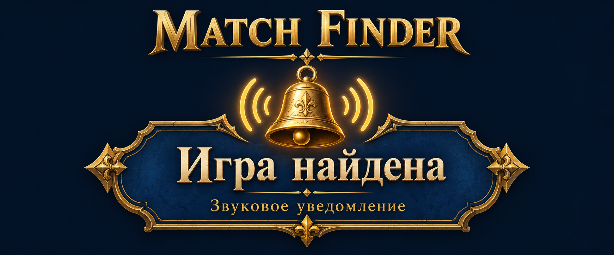

# Match Finder

Иллюстрация звукового уведомления.

Мод подаёт один короткий сигнал, когда в Heroes of Might and Magic: Olden Era найден сетевой матч, а игра свёрнута или находится в фоне. При активном окне игры дополнительного сигнала нет.

**Версия 0.1.3.** Windows x64, Steam build 25672315, Unity 6000.0.66, BepInEx Unity.IL2CPP 6.0.0-be.788.

[Скачать установщик 0.1.3](https://github.com/yusha144/OldenEra-MatchFinder/releases/download/v0.1.3/OldenEra-MatchFinder-0.1.3.zip) · [Все выпуски](https://github.com/yusha144/OldenEra-MatchFinder/releases)

Полностью распакуйте установочный архив и запустите `Install.bat` из корня, рядом с папкой `_files`. Кнопка `Code / Download ZIP` и ссылки `Source code` скачивают исходники для разработки.

[Установка, обновление и удаление](Docs/ops-admin.md) · [Настройки и устройство](Docs/general.md) · [Обратная связь](Docs/feedback.md)

## Как работает мод

- Подаёт сигнал после Alt+Tab, сворачивания игры или переключения на другое окно.
- Использует встроенный звук длительностью 0,72 секунды, независимо от фонового звука игры.
- Обрабатывает событие нахождения матча в Classic, Solo и Arena.
- Исключает повторный сигнал об одном матче и запуск просроченного уведомления.
- Позволяет включать и отключать звук через `Notifications.PlaySound`.

После сигнала переключитесь в игру и примите матч. Громкость регулируется через системные звуки Windows.

## Файлы проекта

| Папка | Содержимое |
|---|---|
| `source` | Код мода и встроенный звук |
| `installer` | Установка и удаление |
| `Docs` | Инструкции, справочник и оформление |
| `development` | Сборка, проверки и генератор звука |

[Сборка из исходников](https://github.com/yusha144/OldenEra-MatchFinder/blob/main/development/README.md) · [Изменения версий](Docs/CHANGELOG.md)

Автор: yusha144. [Лицензия MIT](LICENSE) · [Сторонние компоненты](Docs/third-party-notices.md)
